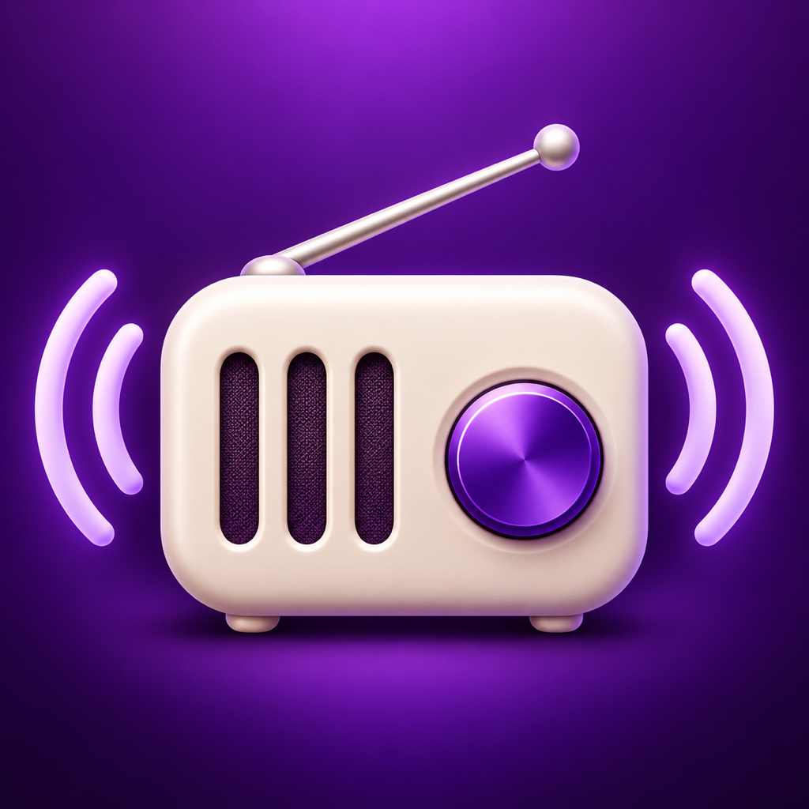

# Deutsia Radio for Apple

<p align="center"></p>

**原生 macOS 电台播放器与 iOS 移植工程，移除 Tor。**

基于 [deutsia/deutsia-radio](https://github.com/deutsia/deutsia-radio) Android v1.8.1 的独立社区移植，采用 Swift / SwiftUI 重写 Apple 平台组件。本项目并非原作者的官方 Apple 版本。

- 原作者：[deutsia](https://github.com/deutsia)
- 移植与界面设计：**Billson**
- AI 辅助开发：**OpenAI Codex**
- 使用模型：**gpt-6.1-sol**

## 状态

| 平台 | 当前状态 |
| --- | --- |
| macOS | **0.1.1 预览版**；Apple Silicon，macOS 13+；本机 ad-hoc 签名，未经 Apple 公证 |
| iOS / iPadOS | **源码与工程阶段**；目标 iOS 17+；未完成 iOS SDK 全量编译、真机验证或签名，无可安装 IPA |

移植仍在进行中，**尚未实现并验证原项目所有非 Tor 功能的完全等价**。详见[实现状态与已知限制](docs/IMPLEMENTATION_STATUS.md)。

## 界面

0.1.1 压缩了顶部横幅与筛选区，采用紧凑电台卡片，给电台列表留出更多空间。

## 功能

- RadioBrowser 电台发现、搜索、国家选单、语言选单及类型筛选。
- 汉语筛选包含全部汉语、普通话／简体中文和粤语；查询合并目录中的常用语言标签，结果依赖社区目录的标注质量。
- 我的电台、收藏、历史、自定义队列、类型管理和电台编辑。
- MP3 / AAC 等 libVLC 支持的音频播放；M3U、PLS、HLS 与 DASH 清单处理。
- 录音、多电台分别录制、切台继续录音选项；当前保存为 MPEG-TS（`.ts`）。
- 均衡器、音量、睡眠定时、菜单栏与系统媒体控制。
- I2P HTTP 代理；macOS 自定义 HTTP、HTTPS、SOCKS4、SOCKS5 代理及认证配置。
- 强制代理模式失败时不自动回退直连；SOCKS5 使用代理端 DNS。I2P 路由器需自行提供。
- JSON / CSV / M3U / PLS 导入与导出。
- PIN 应用锁、生物识别入口、本地 AES-256-GCM 加密。
- 深浅色、六种主题色、17 种语言的基础控件翻译。新文案尚未全部本地化。

Tor 控件、Tor 目录及 `.onion` 电台已移除或拒绝。Android Auto 不适用于 Apple 平台；尚未实现 CarPlay。

## 下载与安装

在本仓库的 [Releases](https://github.com/HeyDx/deutsia-radio-apple/releases) 中下载 macOS Apple Silicon 预览版 DMG，打开后将应用拖入 Applications。

当前应用为本机临时签名，**不是 Apple Developer ID 签名，也未经公证**。请自行检查来源和代码；不建议为运行本应用关闭系统的安全保护。

## 构建 macOS

需要 Apple Command Line Tools 和 [VideoLAN 官方 VLC 3.0.21 arm64](https://download.videolan.org/pub/videolan/vlc/3.0.21/macosx/vlc-3.0.21-arm64.dmg)。将官方 DMG 挂载后：

```sh
VLC_SOURCE="/Volumes/VLC media player/VLC.app/Contents/MacOS" bash build-mac.sh
```

`VLC_SOURCE` 请替换为实际挂载路径。产物位于 `dist/Deutsia Radio.app`。脚本复用已有播放库时不需要重新指定路径。

## 构建 iOS

安装兼容的完整 Xcode、iOS SDK 与 CocoaPods：

```sh
cd iOS
pod install
open DeutsiaRadio.xcworkspace
```

选择自己的开发团队和设备。也可使用 `TEAM_ID=你的团队ID bash build-ios.sh`。不要将证书、私钥、描述文件或账号密码提交到仓库。MobileVLCKit 固定为 `3.6.0`。此构建路径尚未通过 iOS 全量编译和设备验证，可能还需要修正。

## 验证

```sh
bash Tests/run-core.sh
bash Tests/run-integration.sh
```

核心检查为 35 项，覆盖加密、防篡改、钥匙串延迟访问、导入导出、代理失败保护、清单改写及组合筛选。集成测试需要已构建的 Mac 应用播放库、网络连接与本机回环端口，验证公开电台播放／录音及 HLS 播放。在线电台的可用性会变化。

真实 I2P 音频、所有代理协议与认证组合、全部编解码器、在线 DASH 及生物识别仍未完全验证。iOS 暂不支持 SOCKS4，其余代理与认证兼容性仍需真机验证。

## 本地数据与钥匙串

普通启动和未加密资料库的读取／保存不访问钥匙串。只有读取或写入加密数据时，才读取／创建本应用自己的 `com.deutsia.mac.vault / local-encryption-key` 条目。保存代理密码时会加密资料库；不查询其他应用或 Apple ID 的密码。

无云同步和统计遥测。目录、封面及音频请求会连接用户选择的服务。导出的电台文件不包含代理密码。

## 许可证与来源

本项目使用 [Apache License 2.0](LICENSE)，保留 [NOTICE](NOTICE) 中的原作者与移植署名。上游版本为 `v1.8.1`，提交 `38499d6f2555a80de4b7df1b1073f3e0cdb1f124`；基础控件译文派生自上游。

VLC / MobileVLCKit 及其插件适用各自的许可证，不因本仓库的 Apache 许可证而改变。详见[第三方组件说明](THIRD_PARTY_NOTICES.md)及 `Resources/VLC-COPYING*.txt`。
